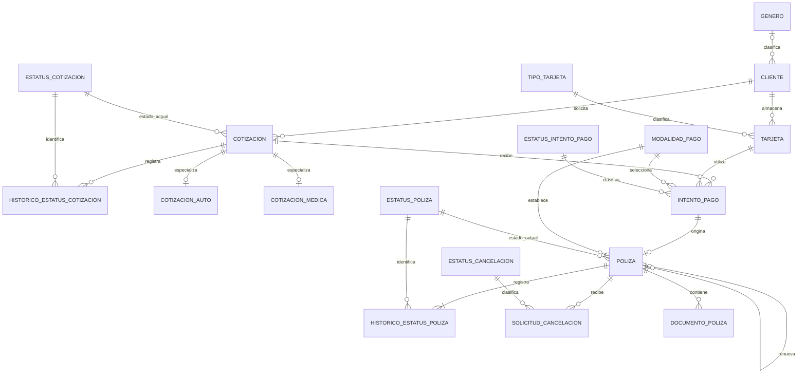

# Modelo relacional de Virtual Insurance para NEDW

**Fecha de definición:** 19 de noviembre de 2026  
**Alcance:** aplicación web de cotización, contratación, pago simulado, consulta de pólizas y solicitud de cancelación.

## 1. Criterios del modelo

- El modelo es exclusivo del proyecto de Negocios Electrónicos y Desarrollo Web.
- Se conservan los nombres de las tablas, claves primarias y atributos del modelo lógico original para las entidades que permanecen en el alcance.
- `GENERO`, `SEXO`, `TIPO_TARJETA` y `TARJETA` permanecen en el sistema.
- `PAGO` se sustituye por `INTENTO_PAGO` para representar tanto operaciones aprobadas como rechazadas.
- Una póliza solo se genera a partir de un intento de pago aprobado.
- `POLIZA` obtiene su cotización mediante `INTENTO_PAGO`; no conserva una segunda relación directa con `COTIZACION`.
- Los datos de tarjeta son ficticios, pero se tratarán como sensibles para demostrar controles de seguridad.
- El CVV se usa únicamente durante la simulación de autorización y nunca se persiste.
- Las reglas que dependan de varias tablas se ejecutarán en una transacción del backend y, cuando sea posible, se reforzarán con restricciones de Oracle.

## 2. Tablas fuera del alcance

Las siguientes tablas del modelo original no se implementarán para NEDW:

- `HUELLA_CLIENTE`
- `FOLIO_SINIESTRO`
- `SINIESTRO`
- `SINIESTRO_AUTO`
- `SINIESTRO_MEDICO`
- `HOSPITAL`
- `AJUSTADOR`
- `UBICACION_AJUSTADOR`
- `ANTECEDENTE_SINIESTRO_AUTO`
- `DROGA`
- `COTIZACION_DROGA`

La aplicación NEDW no autentica mediante biometría, no administra siniestros y no captura un catálogo de drogas.

## 3. Tablas conservadas del modelo original

### 3.1 `GENERO`

| Atributo | Condición |
|---|---|
| `GENERO_ID` | PK, no nulo |
| `CLAVE` | No nulo, único |
| `DESCRIPCION` | No nulo |

Cardinalidad:

- Un género puede asociarse con cero o muchos clientes.
- Un cliente puede asociarse con cero o un género.

`SEXO` y `GENERO_ID` deben tener significados distintos y documentados. `SEXO` representa el dato declarado usado por las reglas que lo requieran; `GENERO_ID` representa la identidad de género seleccionada. No deben utilizarse como sinónimos.

### 3.2 `CLIENTE`

| Atributo | Condición |
|---|---|
| `CLIENTE_ID` | PK, no nulo |
| `NOMBRE` | No nulo |
| `APELLIDO_PATERNO` | No nulo |
| `APELLIDO_MATERNO` | Nulo permitido |
| `FECHA_NACIMIENTO` | No nulo |
| `SEXO` | No nulo |
| `IDENTIFICADOR_FISCAL` | No nulo, único |
| `EMAIL` | No nulo, único |
| `CONTRASENA` | No nulo; contendrá el hash, nunca texto plano |
| `FOTO` | No nulo |
| `GENERO_ID` | FK a `GENERO`, nulo permitido |

Cardinalidades:

- Un cliente puede tener cero o muchas tarjetas.
- Un cliente puede generar cero o muchas cotizaciones.
- Cada tarjeta pertenece a un solo cliente.
- Cada cotización pertenece a un solo cliente.

### 3.3 `ESTATUS_COTIZACION`

| Atributo | Condición |
|---|---|
| `ESTATUS_COTIZACION_ID` | PK, no nulo |
| `DESCRIPCION` | No nulo |
| `CLAVE` | No nulo, único |

Catálogo inicial propuesto:

- `BORRADOR`
- `ENVIADA`
- `APROBADA`
- `RECHAZADA`
- `EXPIRADA`

### 3.4 `COTIZACION`

| Atributo | Condición |
|---|---|
| `COTIZACION_ID` | PK, no nulo |
| `CLIENTE_ID` | FK a `CLIENTE`, no nulo |
| `NUMERO_COTIZACION` | No nulo, único |
| `FECHA_COTIZACION` | No nulo |
| `VIGENCIA_COTIZACION` | No nulo |
| `TIPO_SEGURO` | No nulo; discriminante de auto o médico |
| `COSTO_CALCULADO` | Nulo mientras no exista una decisión |
| `RECHAZO_PDF` | Nulo; solo se genera para una cotización rechazada cuando aplique |
| `ESTATUS_COTIZACION_ID` | FK a `ESTATUS_COTIZACION`, no nulo |

Cardinalidades:

- Un cliente puede tener cero o muchas cotizaciones.
- Una cotización pertenece a exactamente un cliente.
- Un estatus puede corresponder a cero o muchas cotizaciones.
- Una cotización tiene exactamente un estatus actual.
- Una cotización posee exactamente un subtipo: auto o médico.
- Una cotización puede tener cero o muchos intentos de pago.

### 3.5 `HISTORICO_ESTATUS_COTIZACION`

| Atributo | Condición |
|---|---|
| `HISTORICO_ESTATUS_COTIZACION_ID` | PK, no nulo |
| `NUMERO_CAMBIO` | No nulo |
| `FECHA_CAMBIO` | No nulo |
| `ESTATUS_COTIZACION_ID` | FK a `ESTATUS_COTIZACION`, no nulo |
| `COTIZACION_ID` | FK a `COTIZACION`, no nulo |

Cardinalidades:

- Una cotización tiene uno o muchos registros históricos una vez enviada.
- Cada registro histórico pertenece a una sola cotización y registra un solo estatus.
- La combinación `COTIZACION_ID + NUMERO_CAMBIO` debe ser única.

### 3.6 `COTIZACION_AUTO`

| Atributo | Condición |
|---|---|
| `COTIZACION_ID` | PK y FK a `COTIZACION`, no nulo |
| `MARCA` | No nulo |
| `MODELO` | No nulo |
| `ANIO` | No nulo |
| `CATEGORIA` | No nulo |
| `PLACAS` | No nulo |
| `NUMERO_LICENCIA` | No nulo |
| `EDAD_CONDUCTOR` | No nulo |
| `PUNTOS_NEGATIVOS` | No nulo |
| `ANTECEDENTES_PENALES` | No nulo |

Cardinalidad:

- Una cotización de tipo auto tiene exactamente un registro en `COTIZACION_AUTO`.
- Un registro de `COTIZACION_AUTO` corresponde exactamente a una cotización.

### 3.7 `COTIZACION_MEDICA`

| Atributo | Condición |
|---|---|
| `COTIZACION_ID` | PK y FK a `COTIZACION`, no nulo |
| `EDAD_ASEGURADO` | No nulo |
| `HIPERTENSION` | No nulo |
| `GLUCOSA_FUERA_RANGO` | No nulo |
| `COLESTEROL_FUERA_RANGO` | No nulo |
| `FUMADOR` | No nulo |
| `ADICCION_ALCOHOL` | No nulo |

Cardinalidad:

- Una cotización de tipo médico tiene exactamente un registro en `COTIZACION_MEDICA`.
- Un registro de `COTIZACION_MEDICA` corresponde exactamente a una cotización.

### 3.8 `TIPO_TARJETA`

| Atributo | Condición |
|---|---|
| `TIPO_TARJETA_ID` | PK, no nulo |
| `CLAVE` | No nulo, único |
| `DESCRIPCION` | No nulo |

Cardinalidad:

- Un tipo de tarjeta puede clasificar cero o muchas tarjetas.
- Cada tarjeta tiene exactamente un tipo.

### 3.9 `TARJETA`

| Atributo | Condición |
|---|---|
| `TARJETA_ID` | PK, no nulo |
| `CLIENTE_ID` | FK a `CLIENTE`, no nulo |
| `TIPO_TARJETA_ID` | FK a `TIPO_TARJETA`, no nulo |
| `NUMERO_TARJETA` | No nulo; debe almacenarse cifrado |
| `ANIO_EXPIRACION` | No nulo |
| `MES_EXPIRACION` | No nulo |

Reglas:

- El CVV no forma parte de la tabla y nunca debe persistirse.
- El número de tarjeta nunca debe aparecer en registros de aplicación, mensajes de error o respuestas de la API.
- La clave de cifrado no debe almacenarse en la tabla ni versionarse en Git.
- El tipo físico de `NUMERO_TARJETA` se definirá según la estrategia de cifrado elegida para Oracle y Spring.
- No se agrega `ULTIMOS_CUATRO` en esta versión porque no existe una pantalla de administración de tarjetas guardadas.

Cardinalidades:

- Un cliente puede almacenar cero o muchas tarjetas.
- Cada tarjeta pertenece exactamente a un cliente.
- Una tarjeta puede utilizarse en cero o muchos intentos de pago.

### 3.10 `MODALIDAD_PAGO`

| Atributo | Condición |
|---|---|
| `MODALIDAD_PAGO_ID` | PK, no nulo |
| `CLAVE` | No nulo, único |
| `INTERVALO_MESES` | No nulo |

Ejemplos: mensual, trimestral, semestral y anual.

### 3.11 `POLIZA`

Se conservan sus atributos originales, con la excepción acordada de sustituir la relación directa con cotización por la relación con el intento aprobado.

| Atributo | Condición |
|---|---|
| `POLIZA_ID` | PK, no nulo |
| `INTENTO_PAGO_ID` | FK a `INTENTO_PAGO`, no nulo y único; sustituye `COTIZACION_ID` |
| `FOLIO` | No nulo, único |
| `VIGENCIA_DESDE` | No nulo |
| `VIGENCIA_HASTA` | No nulo |
| `COSTO_SEGURO` | No nulo |
| `IVA_IMPORTE` | No nulo |
| `FOLIO_FACTURA` | No nulo, único |
| `FACTURA_JSON` | No nulo |
| `FACTURA_XML` | No nulo |
| `MODALIDAD_PAGO_ID` | FK a `MODALIDAD_PAGO`, no nulo |
| `POLIZA_ANTERIOR_ID` | FK autorreferenciada a `POLIZA`, nulo permitido |
| `ESTATUS_POLIZA_ID` | FK a `ESTATUS_POLIZA`, no nulo; atributo agregado para NEDW |

Cardinalidades:

- Un intento aprobado puede generar cero o una póliza.
- Una póliza se origina en exactamente un intento aprobado.
- La cotización de una póliza se obtiene por `POLIZA → INTENTO_PAGO → COTIZACION`.
- Una modalidad de pago puede utilizarse en cero o muchas pólizas.
- Una póliza puede tener cero o una póliza anterior.
- Una póliza anterior puede ser referencia de cero o muchas renovaciones.
- Un estatus puede corresponder a cero o muchas pólizas.

La relación indirecta evita mantener simultáneamente `POLIZA.COTIZACION_ID` e `INTENTO_PAGO.COTIZACION_ID`, cuyos valores podrían contradecirse.

## 4. Tablas adaptadas o agregadas para NEDW

### 4.1 `ESTATUS_INTENTO_PAGO`

| Atributo | Condición |
|---|---|
| `ESTATUS_INTENTO_PAGO_ID` | PK, no nulo |
| `CLAVE` | No nulo, único |
| `DESCRIPCION` | No nulo |

Catálogo inicial:

- `PENDIENTE`
- `APROBADO`
- `RECHAZADO`

### 4.2 `INTENTO_PAGO`

Sustituye a `PAGO` y conserva sus atributos aplicables.

| Atributo | Condición |
|---|---|
| `INTENTO_PAGO_ID` | PK, no nulo; sustituye `PAGO_ID` |
| `COTIZACION_ID` | FK a `COTIZACION`, no nulo; sustituye `POLIZA_ID` |
| `TARJETA_ID` | FK a `TARJETA`, no nulo |
| `MODALIDAD_PAGO_ID` | FK a `MODALIDAD_PAGO`, no nulo; agregado para conservar la modalidad incluso si el intento es rechazado |
| `NUMERO_PAGO` | No nulo, único |
| `FECHA_PAGO` | No nulo |
| `IMPORTE` | No nulo |
| `COMPROBANTE_PDF` | Nulo; se genera únicamente para intentos aprobados |
| `ESTATUS_INTENTO_PAGO_ID` | FK a `ESTATUS_INTENTO_PAGO`, no nulo; agregado para NEDW |
| `MOTIVO_RECHAZO` | Nulo; agregado para intentos rechazados |

Cardinalidades:

- Una cotización puede tener cero o muchos intentos de pago.
- Cada intento corresponde exactamente a una cotización.
- Una tarjeta puede utilizarse en cero o muchos intentos.
- Cada intento utiliza exactamente una tarjeta.
- Una modalidad puede seleccionarse en cero o muchos intentos.
- Cada intento utiliza exactamente una modalidad.
- Un intento aprobado puede generar cero o una póliza.
- Un intento pendiente o rechazado no puede generar una póliza.

Reglas:

- Solo se permiten intentos para cotizaciones aprobadas y vigentes.
- Como máximo un intento aprobado por cotización puede originar una póliza.
- Un rechazo conserva el intento y su motivo, pero no genera comprobante ni póliza.
- Cuando se emite una póliza, su `MODALIDAD_PAGO_ID` debe coincidir con el del intento que la originó.
- El CVV recibido por la API debe eliminarse de memoria tan pronto termine la simulación y nunca debe registrarse.

### 4.3 `ESTATUS_POLIZA`

| Atributo | Condición |
|---|---|
| `ESTATUS_POLIZA_ID` | PK, no nulo |
| `CLAVE` | No nulo, único |
| `DESCRIPCION` | No nulo |

Catálogo inicial:

- `ACTIVA`
- `CANCELACION_SOLICITADA`
- `CANCELADA`
- `VENCIDA`

### 4.4 `HISTORICO_ESTATUS_POLIZA`

| Atributo | Condición |
|---|---|
| `HISTORICO_ESTATUS_POLIZA_ID` | PK, no nulo |
| `NUMERO_CAMBIO` | No nulo |
| `FECHA_CAMBIO` | No nulo |
| `ESTATUS_POLIZA_ID` | FK a `ESTATUS_POLIZA`, no nulo |
| `POLIZA_ID` | FK a `POLIZA`, no nulo |

Cardinalidades y reglas:

- Una póliza tiene uno o muchos registros históricos desde su emisión.
- Cada registro pertenece a una póliza y registra un estatus.
- `POLIZA_ID + NUMERO_CAMBIO` debe ser único.

### 4.5 `ESTATUS_CANCELACION`

| Atributo | Condición |
|---|---|
| `ESTATUS_CANCELACION_ID` | PK, no nulo |
| `CLAVE` | No nulo, único |
| `DESCRIPCION` | No nulo |

Catálogo inicial:

- `SOLICITADA`
- `APROBADA`
- `RECHAZADA`

### 4.6 `SOLICITUD_CANCELACION`

| Atributo | Condición |
|---|---|
| `SOLICITUD_CANCELACION_ID` | PK, no nulo |
| `POLIZA_ID` | FK a `POLIZA`, no nulo |
| `FOLIO` | No nulo, único |
| `MOTIVO` | No nulo |
| `FECHA_SOLICITADA` | No nulo |
| `COMENTARIOS` | Nulo permitido |
| `ESTATUS_CANCELACION_ID` | FK a `ESTATUS_CANCELACION`, no nulo |
| `FECHA_CREACION` | No nulo |
| `FECHA_RESOLUCION` | Nulo permitido |
| `OBSERVACION_RESOLUCION` | Nulo permitido |

Cardinalidades y reglas:

- Una póliza puede acumular cero o muchas solicitudes a lo largo de su vida.
- Cada solicitud corresponde exactamente a una póliza.
- Una póliza no puede tener dos solicitudes con estado `SOLICITADA` al mismo tiempo.
- Crear una solicitud cambia la póliza a `CANCELACION_SOLICITADA`, pero su cobertura continúa activa.
- Aprobarla cambia la póliza a `CANCELADA`; rechazarla devuelve la póliza a `ACTIVA`.

### 4.7 `DOCUMENTO_POLIZA`

| Atributo | Condición |
|---|---|
| `DOCUMENTO_POLIZA_ID` | PK, no nulo |
| `POLIZA_ID` | FK a `POLIZA`, no nulo |
| `TIPO_DOCUMENTO` | No nulo |
| `NOMBRE_ARCHIVO` | No nulo |
| `CONTENIDO` | No nulo |
| `TIPO_MIME` | No nulo |
| `FECHA_GENERACION` | No nulo |

Cardinalidad:

- Una póliza puede tener cero o muchos documentos.
- Cada documento pertenece exactamente a una póliza.

`FACTURA_JSON`, `FACTURA_XML` y `COMPROBANTE_PDF` permanecen en sus tablas originales. `DOCUMENTO_POLIZA` se utiliza para documentos adicionales mostrados por la aplicación, principalmente la carátula o contrato de la póliza.

## 5. Diagrama resumido de relaciones



La restricción de especialización exige que cada cotización tenga exactamente uno de los dos subtipos, aunque Mermaid muestre cada relación individual como opcional.

## 6. Recorridos de integridad

### Emisión de póliza

```text
CLIENTE
  → COTIZACION aprobada y vigente
  → INTENTO_PAGO aprobado
  → POLIZA activa
  → HISTORICO_ESTATUS_POLIZA
  → DOCUMENTO_POLIZA
```

### Pago rechazado

```text
COTIZACION aprobada
  → INTENTO_PAGO rechazado
  → se conserva MOTIVO_RECHAZO
  → no se crea POLIZA
```

### Solicitud de cancelación

```text
POLIZA activa
  → SOLICITUD_CANCELACION solicitada
  → POLIZA en CANCELACION_SOLICITADA
  → aprobación: CANCELADA
     o rechazo: ACTIVA
```

## 7. Cambios necesarios en React

Para ajustarse al modelo conservado, el frontend deberá recibir mantenimiento en incrementos posteriores:

- Separar nombre, apellido paterno y apellido materno durante el registro.
- Capturar fecha de nacimiento.
- Capturar sexo y género, respetando que género sea opcional según el modelo.
- Capturar identificador fiscal.
- Incorporar fotografía o definir un valor inicial controlado si continúa siendo obligatoria.
- Permitir seleccionar una tarjeta almacenada o registrar una nueva durante la contratación.
- Enviar el CVV únicamente con la solicitud del intento de pago y nunca volver a recibirlo en una respuesta.
- Mostrar el resultado persistido del intento aprobado o rechazado.

## 8. Decisiones de seguridad para tarjetas

- El número de tarjeta ficticio se almacenará cifrado para demostrar protección de datos en reposo.
- La interfaz aceptará únicamente números de demostración documentados y advertirá que no deben ingresarse tarjetas reales.
- La aplicación no expondrá el número completo después de registrarlo.
- El CVV no se almacenará, ni siquiera cifrado.
- Las contraseñas se protegerán mediante hash de una sola vía; no mediante cifrado reversible.
- Las claves criptográficas y contraseñas de Oracle se proporcionarán mediante variables de entorno o un mecanismo de secretos y se excluirán de Git.
- La estrategia concreta de cifrado de `NUMERO_TARJETA` se definirá antes de crear el DDL físico para que el tipo Oracle sea compatible con el valor cifrado.

## 9. Decisiones pendientes antes del DDL

- Definir los valores exactos permitidos para `SEXO` y el catálogo inicial de `GENERO`.
- Decidir cómo se capturará y almacenará `FOTO` en el registro.
- Elegir cifrado en la aplicación o cifrado transparente de Oracle para `NUMERO_TARJETA`.
- Definir tipos físicos, tamaños, columnas identidad, índices y restricciones para Oracle Database 26ai.
- Diseñar la restricción que garantice un solo intento aprobado utilizable por cotización.

